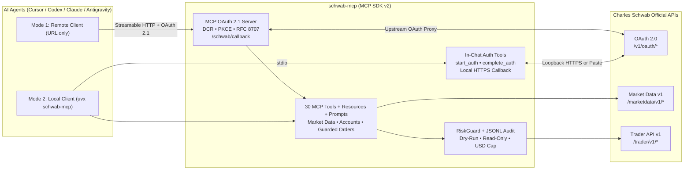

# schwab-mcp

**A production-ready, open-source Model Context Protocol (MCP) server for Charles Schwab Market Data v1 & Trader v1 APIs.**

[](https://www.python.org/downloads/)
[](https://modelcontextprotocol.io/)
[](LICENSE)

English | [简体中文](README.zh-CN.md)

Direct async REST integration with Charles Schwab's official APIs (zero unofficial third-party Schwab SDK dependencies), supporting **stocks, ETFs, and single/multi-leg options**, built-in **multi-layer risk guardrails**, and **two silky-smooth authentication modes** designed for modern AI agents (Cursor, Codex, Claude Desktop, Claude Code, Antigravity, Windsurf, and any MCP client).

---

## Why schwab-mcp?

| Capability | Details |
| :--- | :--- |
| **Mode 1: Remote Hosted (Cloudflare-style OAuth 2.1)** | Deploy once on a public HTTPS domain. Connect from Cursor / Codex / Claude with **just a URL** — native MCP OAuth 2.1 (`/.well-known/oauth-protected-resource`, Dynamic Client Registration, PKCE S256, RFC 8707, refresh rotation, revocation) proxies Charles Schwab OAuth 2.0 seamlessly with per-user token & account isolation. |
| **Mode 2: Local Any-Agent (`uvx schwab-mcp`)** | Pass your Schwab App Key & Secret via `env` or CLI flags in any agent and start immediately. Includes **in-chat `start_auth` / `complete_auth`**, automatic browser launch, local loopback HTTPS auto-capture (zero warnings with optional `mkcert`), and shared `~/.config/schwab-mcp/` token storage across all local agents. |
| **Latest MCP Protocol (`2026-07-28`, SDK v2.3)** | Stateless `server/discover` & per-request `_meta` negotiation, **URL-mode Elicitation** (`ctx.elicit_url`) for out-of-band OAuth, **Streamable HTTP** & **stdio** transports, `ToolAnnotations` on all 30 tools, read-only **MCP Resources**, and guided **MCP Prompts**. |
| **Defense-in-Depth Risk Guardrails** | `SCHWAB_DRY_RUN=true` by default (routes orders to Schwab `previewOrder`, cannot be bypassed by AI args), `SCHWAB_READ_ONLY`, per-order USD notional cap (`SCHWAB_MAX_ORDER_USD`), symbol allow/block lists, mandatory `confirm_live=True`, and `0600` JSONL audit logs. |

---

## Architecture



---

## Prerequisites

1. Register an application on the [Charles Schwab Developer Portal](https://developer.schwab.com/).
2. Enable both **Accounts and Trading Production** and **Market Data Production** products.
3. Wait until your app status is **`Ready for Use`** (not just `Approved`).
4. Register your **Callback URL** in the portal:
   - **Mode 2 (Local stdio)**: `https://127.0.0.1:8182`
   - **Mode 1 (Remote OAuth 2.1)**: `https://schwab-mcp.your-domain.com/schwab/callback`

> **Note on Schwab OAuth**: Charles Schwab enforces OAuth 2.0 Authorization Code flow with a 30-minute access token (auto-refreshed transparently) and a hard **7-day refresh token lifetime**. Re-authentication takes one click every 7 days.

---

## Quick Start: Mode 2 — Pure Local Any-Agent (`uvx schwab-mcp`)

No cloning, no `.env` files, no terminal setup required. Add `schwab-mcp` to any MCP client with your Schwab Developer App credentials:

### Cursor / Claude Desktop / Claude Code / Antigravity / Windsurf

```json
{
  "mcpServers": {
    "schwab": {
      "command": "uvx",
      "args": ["schwab-mcp"],
      "env": {
        "SCHWAB_APP_KEY": "your_schwab_app_key",
        "SCHWAB_APP_SECRET": "your_schwab_app_secret",
        "SCHWAB_CALLBACK_URL": "https://127.0.0.1:8182"
      }
    }
  }
}
```

Or pass credentials directly via CLI arguments (for agents without `env` config):

```bash
uvx schwab-mcp \
  --app-key "your_schwab_app_key" \
  --app-secret "your_schwab_app_secret" \
  --callback-url "https://127.0.0.1:8182"
```

### Smooth First-Time Authentication (Directly Inside Chat)

1. Simply ask your agent: *"Check my Schwab positions and NVDA quote."*
2. If not authenticated yet, the agent automatically calls `start_auth`:
   - Starts a temporary local HTTPS callback listener on `https://127.0.0.1:8182`
   - Opens the Charles Schwab login page in your default browser
3. Sign in and click **Approve**.
   - **Automatic capture**: Your token is saved immediately to `~/.config/schwab-mcp/token.json` (`0600` permissions), shared across all local agents (Cursor, Codex, Claude, Antigravity).
   - **Fallback (headless / skip cert prompt)**: Copy the full redirected URL (`https://127.0.0.1:8182/?code=...`) from the browser address bar and paste it in chat; the agent calls `complete_auth`.

> **Pro tip (zero browser warnings on localhost)**: Run `mkcert 127.0.0.1 localhost` once and set `SCHWAB_TLS_CERT_PATH` & `SCHWAB_TLS_KEY_PATH`. See [docs/authentication.md](docs/authentication.md).

---

## Quick Start: Mode 1 — Remote Hosted (Cloudflare-style One-Click OAuth 2.1)

Deploy `schwab-mcp` once on your VPS behind HTTPS (Caddy, Nginx, or Cloudflare Tunnel), then connect from **Cursor, Codex, Claude, or any remote MCP client** using only a URL — no API keys on client devices, no copy-pasting callback URLs, and zero certificate warnings.

### 1. Start the Server (Docker Compose + Auto-HTTPS Caddy)

```bash
cp .env.example .env
# Edit .env:
#   SCHWAB_APP_KEY=...
#   SCHWAB_APP_SECRET=...
#   MCP_PUBLIC_URL=https://schwab-mcp.your-domain.com
#   MCP_PUBLIC_DOMAIN=schwab-mcp.your-domain.com
docker compose up -d
```

Or run directly without Docker:

```bash
uvx schwab-mcp serve \
  --host 0.0.0.0 \
  --port 8765 \
  --public-url https://schwab-mcp.your-domain.com
```

`SCHWAB_CALLBACK_URL` automatically defaults to `https://schwab-mcp.your-domain.com/schwab/callback` (register this exact URL in Schwab Developer Portal).

### 2. Connect from Any MCP Client (URL Only!)

```json
{
  "mcpServers": {
    "schwab": {
      "url": "https://schwab-mcp.your-domain.com/mcp"
    }
  }
}
```

When you connect, Cursor / Codex / Claude automatically detects MCP OAuth 2.1, shows a **Connect / Authorize** button, redirects you to Charles Schwab login, exchanges tokens server-side, and connects you immediately. See [docs/deployment.md](docs/deployment.md) for Caddy, Nginx, and Cloudflare Tunnel recipes.

---

## Available Tools, Resources & Prompts

### MCP Tools (30 Tools with `ToolAnnotations`)

| Category | Tools |
| :--- | :--- |
| **Authentication (3)** | `get_auth_status`, `start_auth`, `complete_auth` |
| **Market Data v1 (7)** | `get_quotes`, `get_price_history`, `get_option_expirations`, `get_option_chain`, `get_market_movers`, `get_market_hours`, `search_instruments` |
| **Accounts & Orders (7)** | `list_accounts`, `get_account_details`, `get_positions`, `get_orders`, `get_order`, `get_transactions`, `get_user_preferences` |
| **Risk & Helpers (2)** | `get_risk_config`, `build_option_symbol` |
| **Guarded Execution (11)** | `place_equity_order`, `place_option_order`, `place_option_spread_order`, `place_trailing_stop_order`, `place_oco_order`, `place_bracket_order`, `place_trigger_order`, `place_raw_order`, `preview_raw_order`, `replace_order`, `cancel_order` |

### MCP Resources
- `schwab://auth/status` — Live OAuth 2.0 token health & TTL
- `schwab://risk/config` — Active risk guardrails
- `schwab://accounts` — Linked accounts overview

### MCP Prompts
- `safe_order_checklist` — Pre-flight verification workflow before live trades
- `analyze_position` — Position PnL, concentration, and exit protection review
- `option_chain_review` — Expiration, IV, liquidity, and Greeks analysis

---

## CLI Reference

```bash
# Mode 2: Start local stdio MCP server (default)
schwab-mcp

# Mode 1: Start remote Streamable HTTP server with MCP OAuth 2.1
schwab-mcp serve --public-url https://schwab-mcp.example.com --host 0.0.0.0 --port 8765

# Local CLI authentication helpers
schwab-mcp auth login      # Opens browser + captures callback automatically (or --no-auto-callback)
schwab-mcp auth status     # Inspect token TTL & warnings
schwab-mcp auth refresh    # Manually refresh 30-min access token
schwab-mcp auth logout     # Delete local token

# Diagnostics (credentials, callback URL, TLS cert, token health, risk config)
schwab-mcp doctor
```

---

## Risk Guardrails & Live Trading Safety

By default, **`SCHWAB_DRY_RUN=true`** is enforced globally so no real money order can ever be submitted accidentally:

1. **Global Dry-Run Guard (`SCHWAB_DRY_RUN=true`)**: Intercepts all order submissions and runs Schwab's official `previewOrder` endpoint instead. Cannot be overridden by any AI tool parameter.
2. **Global Read-Only Guard (`SCHWAB_READ_ONLY=true`)**: Blocks all live order placements, replacements, and cancellations.
3. **Notional Cap (`SCHWAB_MAX_ORDER_USD`, default `$5,000`)**: Estimates notional value (including live quote lookups for market/trailing orders and smart sizing for OCO/Bracket strategies) and rejects oversized orders.
4. **Symbol Allowlist / Blocklist**: Restrict trading with `SCHWAB_ALLOWED_SYMBOLS` and `SCHWAB_BLOCKED_SYMBOLS` (applies to both equity and underlying symbols of options).
5. **Explicit Live Confirmation + Audit Trail**: Even with `SCHWAB_DRY_RUN=false`, live actions require `confirm_live=True`, and every attempt is logged to `trade_audit.jsonl` (`0600`).

See [docs/security.md](docs/security.md) for full details.

---

## Development

```bash
git clone https://github.com/HGZ-20/schwab-mcp.git
cd schwab-mcp
uv sync --all-extras
uv run pytest -v
```

---

## Disclaimer

This project is an independent, community-maintained open-source MCP server and is **not affiliated with, endorsed by, or officially supported by Charles Schwab & Co., Inc.** Trading equities and options involves substantial financial risk. Always test thoroughly in `SCHWAB_DRY_RUN=true` mode before enabling live execution.

## License

[MIT](LICENSE)
